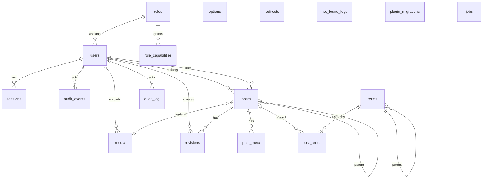
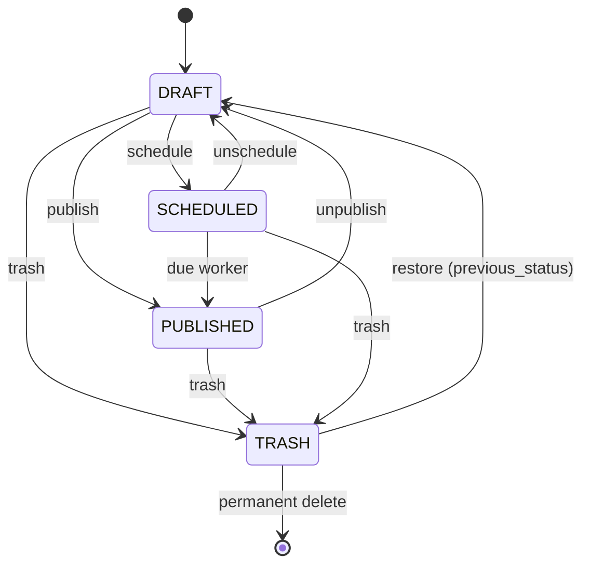

# Content model

Status: Phase 0 proposal, partially implemented. Phase 2's first slice implements
a reduced `users`/`sessions`/`audit_events`/`login_attempts` schema; the content,
taxonomy, media, revision and roles tables remain the target design. Field names
for implemented tables match `packages/database/prisma/schema.prisma`.

## 1. Principles

1. **One content table, many types.** Posts, pages and future plugin content types
   share lifecycle, slug, author, revision and SEO behavior. A `type` discriminator
   and an optional `parent_id` replace the reference's duplicated `Post`/`Page`
   tables.
2. **Typed core, namespaced extension data.** Title, slug, status, dates, author,
   excerpt, featured media and core SEO are columns. Plugin data goes into
   namespaced JSONB, never into core EAV tables.
3. **Raw content is canonical.** `posts.content` stores WordPress-compatible
   block markup. `rendered_html` is a derived cache and may be rebuilt at any time.
4. **UTC instants.** All timestamps are `timestamptz(3)`; the database session is
   UTC. Never store local wall-clock times.
5. **Soft delete with recovery.** Trash keeps the row and the previous status.
   Permanent deletion is explicit and audited.
6. **Forward-only migrations.** Applied migrations are immutable. Destructive
   changes require a backup and an explicit approval.

## 2. Entity-relationship diagram

The Phase 2 first slice deliberately does not create the `roles`,
`role_capabilities`, `posts`, `media`, `terms`, `revisions`, `options`,
`redirects`, `not_found_logs`, `plugin_migrations` or `jobs` tables. They are
future migrations, not hidden current state.

## 3. Tables

### 3.1 `users` (Phase 2 first slice)

| Column | Type | Rules |
| --- | --- | --- |
| `id` | uuid | PK, UUIDv7 (`@default(uuid(7))`) |
| `username` | varchar(32) | normalized lowercase; unique; login identifier |
| `password_hash` | varchar(255) | Argon2id PHC string; never returned by the API |
| `role` | enum | `administrator` only in this slice; roles/capabilities are deferred |
| `status` | enum | `active`, `disabled`; default `active` |
| `created_at`, `updated_at` | timestamptz(6) | database/app defaults |

`email`, display `name`, `slug`, `bio`, `avatar_media_id` and `last_login_at`
are deferred with user administration. Do not expose `password_hash` in any DTO.

### 3.2 `roles` and `role_capabilities` (deferred)

The Phase 2 first slice uses a single `administrator` enum value, not a roles
table. P2-04 will introduce editor/author roles, a capability map and
object-level checks before content routes expose mutations. The design below is
still the target:

| `roles` | Type | Rules |
| --- | --- | --- |
| `id` | uuid | PK |
| `key` | text | unique: `administrator`, `editor`, `author` |
| `name` | text | display |
| `description` | text | nullable |

| `role_capabilities` | Type | Rules |
| --- | --- | --- |
| `role_id` | uuid | FK, cascade |
| `capability` | text | e.g. `post.create`, `post.edit.own`, `post.publish`, `user.manage` |

PK `(role_id, capability)`. Capabilities are strings registered in code; the table
is the grant. Object-level checks (`post.edit.own` vs `post.edit.any`) live in the
capability service, not in the route.

### 3.3 `sessions` (Phase 2 first slice)

| Column | Type | Rules |
| --- | --- | --- |
| `id` | uuid | PK |
| `user_id` | uuid | FK `users.id`, cascade |
| `token_hash` | char(64) | unique; SHA-256 of the opaque session token |
| `csrf_hash` | char(64) | SHA-256 of the session CSRF token |
| `created_at`, `last_used_at`, `expires_at` | timestamptz(6) | absolute + idle expiry |
| `revoked_at` | timestamptz(6) | nullable; logout/expiry/disable |

The raw session token only exists in the HttpOnly cookie. `ip` and `user_agent`
columns are not stored in this slice.

#### `audit_events` (Phase 2 first slice)

| Column | Type | Rules |
| --- | --- | --- |
| `id` | uuid | PK |
| `event_type` | varchar(64) | auth event name |
| `actor_user_id`, `target_user_id` | uuid | nullable FKs, set null on delete |
| `ip_hash` | char(64) | HMAC-SHA256 with `AUTH_HASH_PEPPER` |
| `metadata` | jsonb | reason/identifier HMAC only; no secrets |
| `created_at` | timestamptz(6) | UTC |

#### `login_attempts` (Phase 2 first slice)

| Column | Type | Rules |
| --- | --- | --- |
| `id` | bigserial | PK |
| `key_hash` | char(64) | HMAC of `ip:<ip>` or `user:<username>` |
| `attempted_at` | timestamptz(6) | indexed with `key_hash` |

The seed is an idempotent no-op. The first administrator is created only through
`pnpm auth:bootstrap`.

### 3.4 `posts`

| Column | Type | Rules |
| --- | --- | --- |
| `id` | uuid | PK, UUIDv7 |
| `type` | text | `post`, `page`, or a plugin-registered type; indexed |
| `subtype` | text | nullable; e.g. `landing` later |
| `status` | enum/text | `DRAFT`, `PUBLISHED`, `SCHEDULED`, `TRASH` |
| `title` | text | required; trimmed; max length enforced |
| `slug` | text | normalized; unique per `(type, slug)` in flat MVP, `(type, parent_id, slug)` when hierarchy is enabled; max 200 |
| `excerpt` | text | nullable; plain text or sanitized small HTML |
| `content` | text | canonical WordPress block markup |
| `content_format` | text | `wp_block_html` |
| `content_version` | int | starts at 1; format version, not edit count |
| `rendered_html` | text | nullable derived cache |
| `render_hash` | text | nullable hash of content/settings used for cache |
| `author_id` | uuid | FK `users.id`, set null on delete |
| `parent_id` | uuid | FK `posts.id`, set null; page hierarchy |
| `menu_order` | int | default 0 |
| `featured_media_id` | uuid | FK `media.id`, set null |
| `seo_title` | text | nullable; falls back to `title` |
| `seo_description` | text | nullable; falls back to `excerpt` |
| `canonical_url` | text | nullable; computed default |
| `robots` | text | nullable; `index,follow` default |
| `og_title`, `og_description` | text | nullable; fall back to SEO/title |
| `og_media_id` | uuid | FK `media.id`, set null |
| `published_at` | timestamptz(3) | first publish; nullable |
| `scheduled_at` | timestamptz(3) | nullable; due instant |
| `trashed_at` | timestamptz(3) | nullable |
| `previous_status` | text | nullable; restore target |
| `version` | int | optimistic concurrency; increment on every write |
| `created_at`, `updated_at` | timestamptz(3) | |

Indexes:

- `(type, status, published_at desc)` for public lists.
- `(status, updated_at desc)` for admin lists.
- `(author_id)`, `(parent_id)`, `(featured_media_id)`.
- `(scheduled_at)` partial where `status = 'SCHEDULED'`.
- unique `(type, slug)` for flat MVP; if parent paths are enabled, use a computed
  `path` with a unique constraint.

Rules:

- `PUBLISHED` requires `published_at` (set on first publish; keep it on updates).
- `SCHEDULED` requires `scheduled_at`; a worker transitions to `PUBLISHED`.
- `TRASH` requires `trashed_at` and `previous_status`.
- Public queries always filter `status = 'PUBLISHED'` and `published_at <= now()`.
- `content` size is capped at the API boundary (e.g. 2 MB) and validated as
  block markup; malformed markup is preserved, not executed.
- `version` must match the client's `baseVersion` on update; mismatch returns 409
  with the current version.

### 3.5 `post_meta`

| Column | Type | Rules |
| --- | --- | --- |
| `id` | uuid | PK |
| `post_id` | uuid | FK, cascade |
| `namespace` | text | plugin/theme key, e.g. `acme-seo` |
| `key` | text | validated `[a-z0-9_.-]` |
| `value` | jsonb | size-capped; schema-validated by the owner |
| `created_at`, `updated_at` | timestamptz(3) | |

Unique `(post_id, namespace, key)`. Core SEO fields are **not** stored here; they
are columns (or a typed `post_seo` table if the field set grows). Namespaced JSONB
is for extension data only. Never store secrets.

### 3.6 `terms` and `post_terms`

| `terms` | Type | Rules |
| --- | --- | --- |
| `id` | uuid | PK |
| `taxonomy` | text | `category`, `tag`, or plugin-registered |
| `name` | text | required |
| `slug` | text | unique per `(taxonomy, parent_id)` |
| `description` | text | nullable |
| `parent_id` | uuid | FK `terms.id`, set null |
| `created_at`, `updated_at` | timestamptz(3) | |

| `post_terms` | Type | Rules |
| --- | --- | --- |
| `post_id` | uuid | FK, cascade |
| `term_id` | uuid | FK, cascade |
| `position` | int | optional display order |

PK `(post_id, term_id)`. Index `(term_id, post_id)`.
Categories may be hierarchical; tags are flat in MVP. A term's taxonomy is
immutable after creation (move requires a migration/operation).

### 3.7 `media`

| Column | Type | Rules |
| --- | --- | --- |
| `id` | uuid | PK |
| `filename` | text | stored random name |
| `original_name` | text | display only; sanitized |
| `mime_type` | text | server-detected |
| `size_bytes` | bigint | limit enforced |
| `width`, `height` | int | nullable |
| `path` | text | storage-relative; never user-controlled |
| `alt` | text | accessibility; required for images in the editor UX |
| `title`, `caption`, `description` | text | nullable |
| `metadata` | jsonb | dimensions, thumbnails, EXIF-stripped flags |
| `uploaded_by` | uuid | FK, set null |
| `created_at`, `updated_at` | timestamptz(3) | |

Indexes: `(created_at)`, `(mime_type)`, `(uploaded_by)`.
No executable formats; no SVG in MVP. The original file is retained only if the
storage policy allows it; derivatives are generated server-side.

### 3.8 `revisions`

| Column | Type | Rules |
| --- | --- | --- |
| `id` | uuid | PK |
| `post_id` | uuid | FK, cascade |
| `author_id` | uuid | FK, set null |
| `title` | text | snapshot |
| `excerpt` | text | snapshot |
| `content` | text | snapshot |
| `content_format` | text | snapshot |
| `content_version` | int | snapshot |
| `is_autosave` | boolean | default false |
| `created_at` | timestamptz(3) | |

Index `(post_id, created_at desc)`.
Retention (Phase 8, proposed): keep the latest 20 publish/manual revisions and 7
days of autosaves; configurable later. Restoring creates a **new** revision; it
does not rewrite history.

### 3.9 `options`

| Column | Type | Rules |
| --- | --- | --- |
| `key` | text | PK; validated namespace |
| `value` | jsonb | schema-validated per key |
| `autoload` | boolean | default false; only small boot options |
| `updated_at` | timestamptz(3) | |

Options are for site settings (site name, URL, timezone display, reading
settings). Do not use them as a generic plugin data dump; plugins use their own
tables or `post_meta`.

### 3.10 `redirects` and `not_found_logs`

`redirects`: `id`, `source_path` unique, `destination`, `status_code` (301/302),
`enabled`, `hit_count`, `created_at`, `updated_at`.

`not_found_logs`: `id`, `path`, `referrer`, `user_agent`, `created_at`, with a
retention window. Logging must not store query strings that may contain secrets;
strip or redact.

### 3.11 `audit_log`

`id`, `user_id` (set null), `action` (e.g. `post.publish`), `object_type`,
`object_id`, `metadata` jsonb (no secrets), `ip`, `created_at`.
This is append-only from the application's perspective. Retention/export is an
operational decision.

### 3.12 `jobs` (Phase 8)

For scheduled publishing and other background work:

`id`, `type`, `payload` jsonb, `run_at`, `status` (`pending`, `running`, `done`,
`failed`), `attempts`, `locked_at`, `locked_by`, `last_error`, `created_at`,
`updated_at`.

Claim with `SELECT ... FOR UPDATE SKIP LOCKED`; retry with backoff; park failures
for visibility. This is cleaner than adding six scheduling columns to `posts`.

### 3.13 `plugin_migrations` (Phase 9)

`plugin_key`, `version`, `checksum`, `applied_at`, PK `(plugin_key, version)`.
Plugin migrations run under a Postgres advisory lock, in a transaction where the
SQL permits it, and are recorded only after success.

## 4. Content lifecycle

Rules:

- Publishing sets `published_at` only if null; updates keep the original.
- Unpublishing to draft does not clear `published_at` (it is history); public
  queries use `status`, not `published_at` alone.
- Trash stores `previous_status`; restore returns to it, or to `DRAFT` if the
  previous status is no longer valid.
- Permanent delete requires `post.delete.permanent` capability, a confirmation,
  and an audit entry. It cascades revisions/post_terms/meta; media is not deleted
  automatically (usage must be checked).
- A scheduled post is invisible publicly until the worker publishes it.
- Edits to a published post are live on save (no separate "pending changes" model
  in MVP). Revisions provide recovery.

## 5. Slug rules

1. Normalize Unicode NFKC; trim; lowercase.
2. Transliterate to ASCII where possible; replace whitespace/underscores with `-`;
   collapse runs; strip leading/trailing `-`; remove unsafe characters.
3. Cap at 200 characters (bytes vs chars: enforce both).
4. Reserved words cannot be used as top-level slugs: `admin`, `api`, `login`,
   `logout`, `preview`, `uploads`, `_next`, `sitemap`, `robots`, `feed`, `rss`,
   `search`, `trash`, `new`, `edit`, `settings`, `users`, `media`.
5. Empty result → `untitled-<short-id>`.
6. Uniqueness is per `(type, slug)` in flat MVP; when hierarchy is enabled, per
   `(type, parent_id, slug)`. On conflict, append `-2`, `-3`, …
7. A slug change creates a 301 redirect from the old path if the content was
   published and the old path is not already a redirect source.
8. Reusing an old slug is allowed only if the redirect is removed/updated
   deliberately; the admin must warn.

## 6. Media and content references

- Featured media is a foreign key (`featured_media_id`).
- Inline media in blocks is referenced by media ID and/or URL in block attributes.
  The renderer resolves IDs to current URLs, so replacing a file does not require
  rewriting content.
- Media usage lookup (which posts reference a media ID) is a Phase 6 feature; it
  scans block attributes and the featured relation, not raw HTML only.
- Deleting media is blocked or warns if referenced. A force delete leaves broken
  references; the UI must make that explicit.

## 7. Taxonomies

- `category` is hierarchical; `tag` is flat. Both use the same `terms` table.
- A post can have multiple categories and tags in MVP. A "primary category" can be
  a `post_meta`/column later; do not duplicate the reference's `categoryId` +
  `categories` dual model without a clear need.
- Term slugs are unique per taxonomy (and parent for hierarchical terms).
- Term deletion detaches relationships; it does not delete content.
- Custom taxonomies are registered by plugins (Phase 9) with a string key and a
  validation schema; they use the same tables.

## 8. Extension data

- Plugins may add `post_meta` entries under their namespace, e.g.
  `namespace = "acme-events"`, `key = "start_at"`.
- Plugins may add their own tables via plugin migrations. They must not alter core
  tables directly; instead they add nullable columns through a reviewed migration
  only if the core team accepts the feature.
- Plugin data must be exportable: a documented export hook and a namespaced JSON
  dump. Do not hide critical data in an opaque blob.
- No secrets in post meta/options. API keys belong in environment/config, not
  content.

## 9. Database choice

**PostgreSQL only.** Reasons: relational integrity, transactions, constraints,
JSONB for extension metadata, full-text search, `FOR UPDATE SKIP LOCKED` for
workers, and a mature backup/restore path. SQLite is rejected as a second schema
path; MongoDB is rejected because the CMS is relationship-heavy and migration
discipline is a core requirement.

## 10. Migration approach

- Prisma Migrate with SQL migration files committed to the repository.
- Naming: `YYYYMMDDHHMMSS_short_description`.
- Every migration is reviewed for locking/timeouts, data backfills, defaults and
  reversibility. Destructive changes require a backup and an explicit approval.
- Deploy with `prisma migrate deploy`; local development with `prisma migrate dev`.
- The seed script is idempotent (`upsert` by natural keys) and safe to re-run.
- From an empty database: `migrate deploy` then `seed` must produce a working
  install.
- From the previous release: `migrate deploy` must succeed without manual SQL.
- Plugin migrations are separate (Phase 9), versioned per plugin and tracked in
  `plugin_migrations`.
- Test both paths in CI: empty database and previous-schema snapshot.

## 11. Open questions for Phase 1

1. Exact Prisma enum vs text+check for `status`/`type`. Enums are safer but harder
   to extend for plugin content types. Proposal: enum for core status; text +
   check for `type`, validated by the code registry.
2. Whether core SEO fields live in `posts` columns or a `post_seo` table. Start
   with columns for title/description/canonical/OG; split if the field set grows.
3. Whether page paths are computed from `parent_id` or stored. Start flat for MVP;
   add a `path` column with a unique index when hierarchy is implemented.
4. Revision retention numbers (Phase 8).
5. Whether `jobs` is a core table or a plugin/module. Proposed core, because
   scheduled publishing is a core capability.
