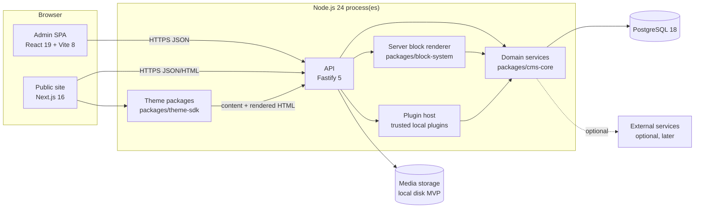
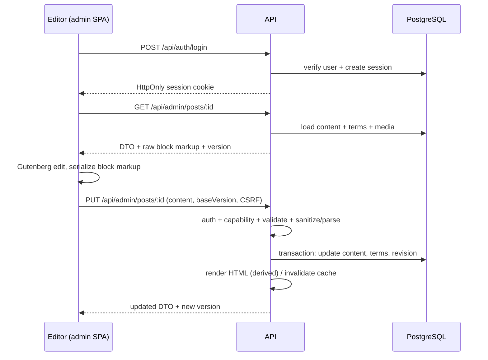
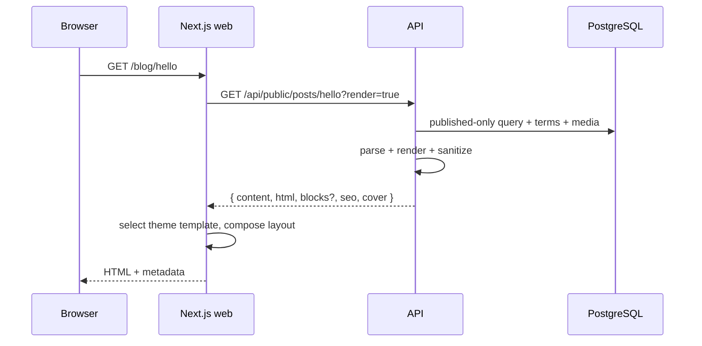
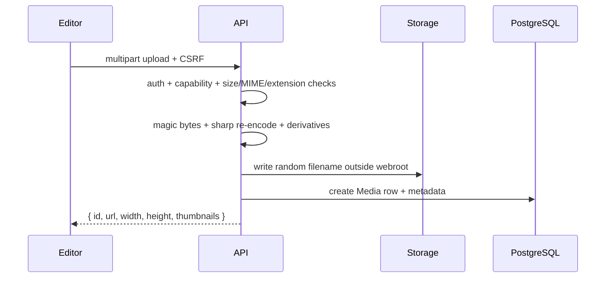

# System overview

Status: Phase 1 foundation implemented. The applications and database package
exist; no CMS feature exists yet. This document remains the target architecture.

## 1. Goals and constraints

MERNPress is a **modular monolith**: one repository, three deployable apps, shared
packages and explicit boundaries. It is not a microservice system. The constraints
that shape the design are:

- A small, solo/hobby project with a low operational burden.
- A WordPress-like admin and a real Gutenberg editor.
- A separately managed theme/template layer.
- A versioned plugin API with trusted local plugins.
- PostgreSQL as the source of truth.
- Local-first setup; deployment later without mandatory paid services.
- Security and accessibility as first-class requirements.

## 2. Components



| Component | Responsibility | Must not |
| --- | --- | --- |
| `apps/admin` | Login, dashboard, content lists, editor, media, users, settings; browser-only | Import Prisma/DB/Node internals; render public pages |
| `apps/api` | HTTP API, auth/session, authorization, validation, content services, canonical block rendering, media upload/serving, plugin host | Own presentation/theme layout; import browser-only WordPress packages |
| `apps/web` | Public routes, theme selection, layout/chrome, SEO metadata, caching/revalidation | Import Prisma/API internals; re-implement core block rendering in MVP |
| `packages/contracts` | Isomorphic DTOs, Zod schemas, error codes, route types | Import Node, React, database or editor code |
| `packages/database` | Prisma schema/client, migrations, repositories | Contain HTTP or UI concerns |
| `packages/cms-core` | Content lifecycle, auth/capabilities, slug/taxonomy/media services, hook bus | Depend on Fastify/React |
| `packages/block-system` | Block contracts/registry, parser, sanitizer, server renderers, editor helpers (separate entrypoints) | Put React into the server entrypoint or Node code into the browser entrypoint |
| `packages/plugin-sdk` | Public plugin interfaces, manifest types, test helpers | Expose internal tables/services as stable API |
| `packages/theme-sdk` | Theme manifest, template/part contracts, tokens, preview/cache helpers | Bind themes to Next-only APIs |
| `themes/*` | Trusted presentation packages | Access the database directly |
| `plugins/*` | Trusted local extensions | Assume sandboxing; auto-download remote code |

## 3. Why a modular monolith

- A CMS has tightly coupled domain invariants (content, terms, media, revisions,
  capabilities). Distributing them across services adds network failure modes and
  distributed transactions for no MVP benefit.
- One API process is easy to run, test and deploy. It can be scaled horizontally
  later if needed.
- Package boundaries give most of the maintainability benefit of services without
  the operational cost.
- The API is the only component that touches the database. Admin and web consume
  HTTP. This keeps the door open to splitting a worker or public read service later.

**Revisit trigger:** a background worker (scheduled publishing, image processing,
email) grows enough to need independent scaling. Even then, it can share the same
database/package layer; a full microservice split is not required.

## 4. Request and content flow

### 4.1 Admin edit/save



Key rules:

- The browser sends **raw block markup** and a base version. The server validates
  size/format, checks authorization, and persists atomically.
- The client is not trusted to set author, status transitions, capabilities or
  rendered HTML.
- The API may store a derived `rendered_html` cache and a `render_hash`; the raw
  `content` remains canonical.

### 4.2 Public read



- Public endpoints only return published, non-trashed content.
- Preview/draft content uses a separate signed token endpoint in Phase 8.
- The web app caches by tag/path and revalidates via a secret-protected webhook.
- The theme controls layout/chrome; the API controls content HTML.

### 4.3 Media upload



- Uploads are never trusted by extension/MIME alone.
- Serving is controlled by the API or a static handler with traversal protection.
- No SVG in MVP.

## 5. Package boundaries

```text
apps/admin  ──> packages/contracts
            ──> packages/block-system/editor
            ──> packages/theme-sdk (types only, optional)

apps/api    ──> packages/contracts
            ──> packages/cms-core
            ──> packages/database
            ──> packages/block-system/render
            ──> packages/plugin-sdk

apps/web    ──> packages/contracts
            ──> packages/theme-sdk
            ──> themes/*

packages/cms-core      ──> packages/contracts, packages/database
packages/database      ──> (Prisma only)
packages/block-system  ──> packages/contracts (contracts entrypoint)
packages/plugin-sdk    ──> packages/contracts, packages/block-system/contracts
packages/theme-sdk     ──> packages/contracts
```

Enforcement:

- ESLint `no-restricted-imports` rules per package/app (Phase 1).
- Separate `exports` entrypoints for browser/server code.
- A dependency-cruiser or `madge` check in CI if the graph grows; start with lint
  rules and code review.
- No barrel file that re-exports server code from a browser entrypoint.

### Layout deviations from the candidate diagram

The Phase 0 candidate layout is intentionally not copied wholesale:

- `packages/config` is **not** created initially. A root `tsconfig.base.json` and
  root ESLint/Prettier config are enough for three apps and a few packages.
  Promote config to a package only when an external consumer or a second
  toolchain needs it.
- `themes/starter-theme` is created in Phase 10, not Phase 0. The Phase 7 web app
  can use an internal layout until the theme contract exists.
- `plugins/example-plugin` is created in Phase 9 as a contract fixture, not before
  the plugin API exists.
- `packages/cms-core`, `plugin-sdk`, `theme-sdk` and `block-system` are created
  when their first real consumer exists, not as empty directories.
- `apps/web` exists from Phase 1 as a bootable skeleton; it does not render CMS
  content until Phase 7.

## 6. Local runtime

| Process | Port (Phase 1) | Command |
| --- | --- | --- |
| API | 4000 | `pnpm --filter @mernpress/api dev` |
| Admin | 5173 | `pnpm --filter @mernpress/admin dev` |
| Web | 3000 | `pnpm --filter @mernpress/web dev` |
| PostgreSQL | 5432 (system) / 55432 (optional project cluster) | native service or `pnpm db:local:start` |

Phase 1 implements: `apps/api`, `apps/admin`, `apps/web` and
`packages/database`. `packages/contracts`, `cms-core`, `block-system`,
`plugin-sdk`, `theme-sdk`, `themes/*` and `plugins/*` remain future packages; no
empty placeholder package was created.

- The admin dev server proxies `/api` to 4000 (Vite `server.proxy`).
- The web app uses `CMS_API_URL` server-side and `NEXT_PUBLIC_SITE_URL` for
  canonical URLs; do not expose the database or secrets to the browser.
- Environment validation runs at process start and fails fast with a clear message.
- A single `pnpm dev` starts all three via Turborepo; each app can also run alone.

<a id="deployment-model"></a>
## 7. Deployment model

```text
[ reverse proxy / TLS ]
        |            |
     /api          / (web)
        |            |
   [ API ]       [ Next ]
        |            |
        +--> [ PostgreSQL ]
        +--> [ media storage ]
```

- One API deployment, one Next deployment, one PostgreSQL instance. A reverse
  proxy terminates TLS and routes `/api` and `/` (or separate hostnames).
- Media can be served by the API or a static file server; the storage interface
  hides the choice.
- Background work (scheduled publishing, image derivatives) can start as an
  in-process sweeper with a DB lock, then move to a separate worker if needed.
- No Vercel/cloud-specific requirement. `next build` with `output: "standalone"`
  is the documented self-host path.
- Backups: `pg_dump` plus media; restore drill before any public launch.

## 8. Cross-cutting concerns

| Concern | Where it lives | Rule |
| --- | --- | --- |
| Auth/session | `cms-core` + API plugin | Opaque session cookie; server-side revocation |
| Authorization | `cms-core` capability service | Object-level checks in services, not only routes |
| Validation | `packages/contracts` + API boundary | Zod; no unvalidated body/query |
| Logging | API (pino) | Request ID, redaction, no secrets/PII |
| Errors | `packages/contracts` + API | Stable codes; no stack traces to clients |
| Rendering | `packages/block-system` | One registry; sanitize; preserve unknown blocks |
| Caching | API + web | Explicit tags; preview no-store; revalidation secret |
| Extensibility | `cms-core` hook bus + plugin host | Typed hooks; trusted local code |
| Theming | `theme-sdk` + web adapter | Framework-agnostic components; no DB access |
| Migrations | `packages/database` | Forward-only; reviewed; backup before destructive |
| Accessibility | Admin + theme | Keyboard, focus, labels, errors, contrast; tested |

## 9. What is deliberately not in the MVP

- Microservices, message queues, Redis, Elasticsearch.
- Multi-tenancy, multisite, billing, marketplace.
- A visual theme editor.
- A plugin sandbox.
- Real-time collaboration.
- Cloud storage/CDN integration (the storage interface is enough).
- Comments, forms, CRM, outreach, e-commerce.

These are deferred because they add operational or security surface without
proving the core content workflow. See [mvp-definition.md](../roadmap/mvp-definition.md).

## 10. Open design questions

1. Should the API serve media directly or delegate to a static file server in
   production? The storage interface makes this reversible; decide in Phase 6.
2. Should the web app call the API for every request or use a build-time cache?
   Start with request-time tag caching; measure.
3. Should background sweeps run in the API process or a separate worker? Start
   in-process with a DB lock; split when scheduling becomes a real load.
4. Should the admin and web share a component library? Only tokens/primitives;
   do not couple the Gutenberg editor to the public theme.
