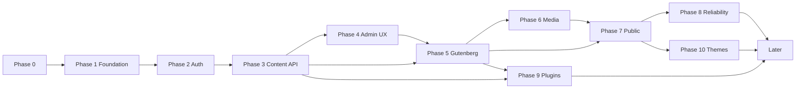

# Roadmap

Status: Phase 0 baseline. Each phase ends with a **stop gate**: report evidence,
manual test steps and limitations, then wait for approval before the next phase.

Principles:

- One vertical slice at a time.
- A working, testable result beats a broad unfinished scaffold.
- Each phase has explicit acceptance criteria and a rollback/repair note.
- Do not start a later phase to avoid finishing the current one.

## Phase 0 — Research and architecture baseline

**Status: complete pending review.**

Deliverables: reference audit, feature matrix, WordPress audit, stack comparison,
OpenCode tooling audit, system/content/Gutenberg/plugin-theme architecture, ADR,
roadmap, MVP definition, testing strategy, threat model, implementation log.

**Exit gate:** owner reviews the docs and approves. No product code before that.

**Rollback:** docs are versioned; revert the commit if a decision is rejected.

## Phase 1 — Repository foundation

**Status: implementation complete 2026-10-25; owner manual acceptance pending.**

**Goal:** a clean clone installs, configures, migrates, runs and passes checks.

Scope:

- pnpm workspace + Turborepo + TypeScript strict + ESLint/Prettier.
- Node 24 pin, pnpm pin, `.env.example`, env validation.
- `packages/database` with an intentionally empty Prisma schema, zero migrations,
  a documented no-op `db:migrate`, UTC sessions and verified UUIDv7.
- `apps/api` Fastify skeleton with `/api/health`, `/api/ready`, error envelope,
  logging, CORS/helmet/cookies, graceful shutdown.
- `apps/admin` Vite skeleton (login placeholder, no content features).
- `apps/web` Next skeleton (a public placeholder page).
- Vitest + Playwright smoke tests; CI with PostgreSQL service.
- `pnpm dev`, `pnpm db:migrate`, `pnpm db:seed`, `pnpm setup`.
- Clean-clone documentation tested on this machine (native PostgreSQL; Docker
  optional).

Acceptance criteria:

1. `pnpm install --frozen-lockfile` succeeds on Node 24.22.x.
2. `pnpm lint`, `pnpm typecheck`, `pnpm test`, `pnpm build` pass.
3. `pnpm db:migrate` succeeds on a fresh empty database and is an explicit no-op
   (zero migrations); `pnpm db:seed` is idempotent and creates no CMS data.
4. `pnpm dev` starts API/admin/web; `/api/health` returns 200; `/api/ready`
   returns 200 with the DB and 503 without it.
5. A trivial Playwright test opens the admin and web placeholders.
6. CI is green.
7. No CMS content feature is implemented.

**Size:** M/L. **Depends on:** Phase 0 approval. **Rollback:** revert the phase
commit; the database is empty and disposable.

## Phase 2 — Authentication and capabilities

**Status: first vertical slice implemented 2026-10-25; owner manual acceptance
pending.** Bootstrap, Argon2id, database-backed sessions, login/logout/current
session, CSRF/Origin, DB-backed login rate limiting, request-ID validation and
the minimum login UI are done. Roles/capabilities, user administration, profile,
password reset, email and MFA remain.

**Goal:** a secure first-admin login and server-enforced authorization.

Scope:

- First-admin bootstrap (CLI/seed; idempotent; no password in logs).
- Argon2id password hashing; opaque session token hashed in DB; HttpOnly/Secure/
  SameSite cookie; rotation; logout; session revocation.
- CSRF defense (origin check + token) and login rate limiting.
- Roles (`administrator`, `editor`, `author`) and capability map; object-level
  checks.
- User administration (create/edit/deactivate; protect last admin).
- Login/logout/profile/users UI with accessible errors and focus.
- Audit events for login, logout, user changes.

Acceptance criteria:

1. First admin can be created from a clean DB and log in.
2. Wrong password/unknown user/suspended user fail with a generic message; rate
   limiting triggers after the configured threshold.
3. Session cookie flags verified; logout revokes; a stolen/expired token is
   rejected.
4. An editor cannot access admin-only routes; an author cannot edit another
   author's content; server returns 403, not just UI hiding.
5. CSRF token required for state-changing requests; a request without it fails.
6. Tests cover unauthenticated, wrong-role, wrong-object and malformed input.
7. Manual test steps documented.

**Size:** M. **Depends on:** Phase 1. **Rollback:** revert code/migration; rotate
secrets; existing sessions invalidated.

## Phase 3 — Core content model and API

**Goal:** posts and pages can be created, edited, published, trashed and read
through a typed API.

Scope:

- Unified `posts` table (post/page type), statuses, author, dates, slug, excerpt,
  featured media, core SEO fields, version.
- Slug service with uniqueness, reserved words and redirects.
- Content service/repository: create/read/update/list/search/paginate; draft/
  publish/trash/restore; optimistic concurrency.
- Admin API + public published-only API; Zod validation; pagination/error
  contracts.
- Categories/tags and assignment.
- Seed/demo content.
- API tests for authorization, validation, conflicts and lifecycle.

Acceptance criteria:

1. Create a draft post and page; publish, unpublish, trash, restore.
2. Public API returns only published content; drafts/trash are 404.
3. Duplicate slug returns a clear conflict or a `-2` slug per the documented rule;
   changing a published slug creates a redirect.
4. Validation rejects missing title, oversized content, invalid status/type,
   invalid term IDs and malformed pagination.
5. An author cannot edit another author's post; an editor can; an admin can.
6. Concurrent updates with a stale `baseVersion` return 409 and do not overwrite.
7. Tests pass; manual `curl`/HTTP steps documented.

**Size:** L. **Depends on:** Phase 2. **Rollback:** migration down is not assumed;
restore the DB backup and revert code.

## Phase 4 — Admin content UX

**Goal:** an editor can manage content comfortably in a WordPress-inspired admin.

Scope:

- Admin shell/nav, responsive layout, skip link, keyboard navigation.
- Posts/pages list tables: filters, search, pagination, bulk actions, empty/
  loading/error states.
- Create/edit forms: title, slug, excerpt, status, author, date, media, terms;
  validation and notices; unsaved-changes guard.
- Dashboard with a few real counts.
- Accessibility pass (axe + keyboard walkthrough).

Acceptance criteria:

1. A non-technical tester can create, publish, unpublish, trash and restore a page
   without reading code.
2. Lists handle empty/loading/error and large pages.
3. Forms show inline validation and a clear save success/failure notice.
4. Navigating away with unsaved changes prompts.
5. Keyboard-only walkthrough works for the main flows; focus is visible; dialogs
   trap/restore focus.
6. No console errors; responsive at tablet width.
7. Manual test script and screenshots/notes recorded.

**Size:** L. **Depends on:** Phase 3. **Rollback:** revert UI; API remains.

## Phase 5 — Gutenberg foundation

**Goal:** a real block editor that loads, edits and saves a scoped block set with
round-trip fidelity.

Scope:

- Pin/verify the WordPress package set; one copy of store-owning packages.
- Standalone editor bootstrap with toolbar, inspector, inserter, list view,
  keyboard shortcuts, scoped CSS.
- Shared block registry/schemas; editor/renderer single source.
- Initial 11 blocks: paragraph, heading, list, quote, image, buttons, columns,
  group, cover, separator, spacer.
- WordPress-compatible raw markup persistence; official parser v6 (or documented
  port); unknown-block preservation.
- Server renderer + sanitizer + golden tests.
- Playwright editor load/edit/save/reload.
- Bundle/lazy-load/performance gate.

Acceptance criteria:

1. Each supported block can be inserted, edited and saved.
2. Reload shows the same content; raw markup is WordPress-compatible.
3. Nested columns/group/buttons round-trip; unknown block fixture is preserved.
4. XSS payloads are neutralized; no `javascript:` URLs.
5. Golden render tests pass; no duplicate-store warnings; browser console clean.
6. Editor bundle budget is documented and met (lazy route, chunking; no 4 GB heap).
7. Manual test steps for every block.

**Size:** XL. **Depends on:** Phase 4. **Rollback:** feature-flag the editor route;
content remains raw markup and can be exported.

## Phase 6 — Media library

**Goal:** safe uploads and a usable media chooser.

Scope: upload pipeline (size/MIME/magic bytes/extension), sharp derivatives, alt/
caption/title, listing/search, featured image, editor media modal, usage lookup,
controlled serving, orphan/delete policy.

Acceptance criteria:

1. Upload JPEG/PNG/WebP/AVIF within limits; reject executable/SVG/oversized/
   spoofed types.
2. Derivatives and dimensions are correct; EXIF is stripped.
3. Editor inserts an image and featured image; reload preserves it.
4. Path traversal and unauthorized upload/delete are rejected.
5. Deleting referenced media warns/blocks; orphan policy documented.
6. Tests cover spoofed MIME, traversal, oversized files and permissions.

**Size:** L. **Depends on:** Phase 5 (editor) and Phase 2 (auth). **Rollback:**
disable upload route; existing files remain.

## Phase 7 — Public rendering

**Goal:** a public site renders published posts/pages with SEO and a starter theme.

Scope: public API contract (published-only, HTML + SEO), Next app, template
fallback chain, post/page/archive/search/404 routes, metadata/canonical/OG,
sitemap/robots, safe HTML rendering, cache/revalidation, starter theme.

Acceptance criteria:

1. A published page/post is visible at its public URL; drafts/trash are 404.
2. Title/description/canonical/OG are correct; no duplicate canonical.
3. Sitemap includes published URLs only; robots is sane.
4. Cache revalidates on publish/update; preview is no-store/noindex (Phase 8).
5. Theme renders without importing Prisma/API internals.
6. Responsive, keyboard-accessible, Lighthouse/axe smoke check recorded.
7. XSS regression test on rendered content.

**Size:** L. **Depends on:** Phase 5. **Rollback:** point the web app at a
maintenance page; API remains.

## Phase 8 — Editorial reliability

**Goal:** editors can recover from mistakes and schedule content.

Scope: revisions/diff/restore, autosave/conflict, signed preview, scheduled
publishing with a job worker, failure visibility, recovery UX.

Acceptance criteria:

1. Autosave survives a reload/crash; conflicts are detected, not overwritten.
2. Revision list/diff/restore works; restore creates a new revision.
3. Preview links are signed, short-lived, draft-only, noindex, no-store.
4. Scheduled content publishes within the window; failures are visible/retryable;
   no duplicate publish.
5. Tests cover concurrency, expiry, retry and authorization.
6. Manual test script.

**Size:** L. **Depends on:** Phase 6/7. **Rollback:** disable scheduler; preview
tokens expire; revisions are additive.

## Phase 9 — Extension contracts

**Goal:** a documented plugin API with a working sample plugin.

Scope: hook/filter bus, manifest/discovery/enablement, lifecycle, plugin
migrations, custom content types/taxonomies, blocks, admin pages, settings,
capabilities, sample plugin, test harness, security review.

Acceptance criteria:

1. Sample plugin activates/deactivates/uninstalls without corrupting core data.
2. Its migration is idempotent and tracked; a failed migration rolls back.
3. Dependency order/conflict detection works; a duplicate name fails at startup.
4. Hooks run in priority order; async/error isolation tested.
5. Custom content type/taxonomy/block/settings/admin page all work.
6. Docs state clearly: trusted code, no sandbox, no remote install.
7. Security review recorded.

**Size:** XL. **Depends on:** Phase 3/5. **Rollback:** disable plugins; plugin
tables remain by default.

## Phase 10 — Theme contracts

**Goal:** a second theme can be installed and switched without touching content.

Scope: theme manifest/loader, template fallback chain, parts, tokens, config
switching, preview/revalidation, starter theme v2, developer guide.

Acceptance criteria:

1. The starter theme and a minimal second theme both render the same content.
2. Switching themes requires only config + rebuild/restart; no content rewrite.
3. Missing templates fall back safely; a broken theme does not take down the site.
4. Theme compatibility check refuses the wrong API major.
5. Accessibility/responsive checks pass for both themes.
6. Docs cover creating a theme and the content/presentation boundary.

**Size:** L. **Depends on:** Phase 7. **Rollback:** switch back via config.

## Phase 11+ — Later

Menus, comments, advanced taxonomies/fields, search, SEO improvements, backups/
restore drill, i18n, analytics, forms/CRM (plugins), commerce (out of scope),
multisite (out of scope).

Order should be driven by actual use and testing, not by a wish to match
WordPress. Each item needs its own slice, acceptance criteria and security review.

## Cross-phase gates

Every phase:

- ADR/decision log updated before code.
- Tests at the right layers; no hidden skipped tests.
- Security review proportional to the change.
- Accessibility check for UI.
- Docs and implementation log updated.
- Manual test steps and rollback notes.
- Owner approval before the next phase.

## Dependency graph

