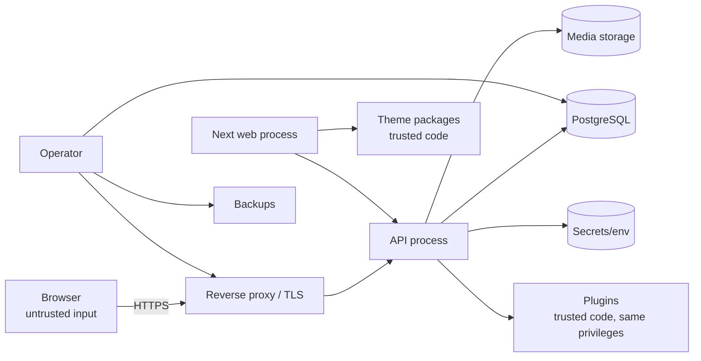

# Threat model

Status: Phase 0 baseline, reviewed in Phase 1 and Phase 2. Phase 1 foundation and
the Phase 2 authentication first slice are implemented; owner manual acceptance
of the auth slice is pending. Review at every phase that changes authentication,
authorization, uploads, rendering, plugins or deployment.

This document is a working model, not a certification. MERNPress is a hobby/
self-hosted CMS in its first version. It must not claim production-grade security,
HIPAA compliance, PCI compliance or multi-tenant isolation.

Phase 2 first slice now implements: Argon2id administrator credentials, opaque
SHA-256-hashed sessions, HttpOnly/SameSite/Secure cookie rules, idle/absolute
expiry, session revocation, login/logout/current-session endpoints, Origin +
CSRF checks with separate pre-auth and session-bound cookies, database-backed
dual-key login rate limiting with bounded retention and coalesced audit, a
bootstrap-only administrator CLI, HMAC-peppered audit/rate-limit identifiers,
bounded auth bodies and strict request-ID validation. The supported deployment
is same-origin admin + `/api` reverse proxy. Roles/capabilities, user
administration, password reset/email, MFA and all content features remain out of
scope.

## 1. Scope and assumptions

In scope:

- The admin SPA, API, public Next.js site, PostgreSQL, local media storage.
- Trusted local plugins/themes.
- Self-hosting behind a reverse proxy with TLS.
- A single site/tenant.

Assumptions:

- The server OS, Node runtime, PostgreSQL and reverse proxy are patched by the
  operator.
- The database is not exposed to the public internet.
- Admin access is restricted to trusted editors/administrators.
- Plugins/themes are reviewed before installation; they are not untrusted code
  from a marketplace.
- Backups are stored securely and tested.
- No paid WAF/CDN is assumed.

Out of scope for MVP:

- Multi-tenancy, untrusted plugin sandboxing, PCI/payment data, HIPAA/PHI
  compliance, full GDPR automation, DDoS mitigation at scale, supply-chain
  attestation for every dependency.

## 2. Assets

| Asset | Why it matters | Where it lives |
| --- | --- | --- |
| Content (drafts/published) | Primary user data; integrity/reputation | PostgreSQL |
| User credentials/sessions | Account takeover | PostgreSQL + HttpOnly cookie |
| Capabilities/roles | Authorization boundary | PostgreSQL |
| Media files | User data, possible PII; upload attack surface | Disk/object storage |
| Secrets (DB URL, session key, SMTP) | Full compromise if leaked | Environment/config |
| Plugin/theme code | Runs with server privileges | Repository/node_modules |
| Backups | Full data + secrets if unencrypted | Operator storage |
| Audit logs | Investigation/recovery | PostgreSQL/logs |
| Public SEO/metadata | XSS/SEO poisoning | PostgreSQL + rendered HTML |

## 3. Actors

| Actor | Trust | Capabilities |
| --- | --- | --- |
| Anonymous visitor | Untrusted | Read published content, login page |
| Author | Low trust | Create/edit own drafts; no publish unless granted |
| Editor | Medium trust | Edit/publish content, manage terms/media |
| Administrator | High trust | Users, settings, plugins/themes, destructive actions |
| Plugin/theme code | Trusted code, not sandboxed | Same OS/DB/env privileges as the server |
| Operator | Trusted | Server, database, backups, secrets |
| External attacker | Untrusted | Network/API/browser/content inputs |
| Supply-chain attacker | Untrusted | Dependency/package compromise |

## 4. Trust boundaries

Boundaries:

1. Browser → API/web: all input untrusted; authenticate and validate.
2. API → DB: parameterized queries; least-privilege DB user.
3. API → filesystem: path confinement; no user-controlled paths.
4. API → plugin code: **not a security boundary**; trusted code.
5. Web → theme code: **not a security boundary**; trusted code.
6. Operator → server: trusted, but least privilege and audited changes.

## 5. Threat table

| ID | Threat | Impact | Likelihood | Mitigations | Residual |
| --- | --- | --- | --- | --- | --- |
| T-01 | Credential stuffing/brute force on login | Account takeover | High | Argon2id, rate limit/backoff, generic errors, optional 2FA later, strong password policy | Determined attacker with valid credentials |
| T-02 | Session theft via XSS or network | Account takeover | Medium | HttpOnly/Secure/SameSite cookies, CSP, short expiry, rotation, revocation, no tokens in localStorage | Malware/browser compromise |
| T-03 | CSRF on state-changing requests | Unauthorized actions | Medium | SameSite + Origin check + CSRF token; no GET mutations; CORS allowlist | Same-site attacker with a token |
| T-04 | Session fixation | Account takeover | Low | New token on login, rotation, no token in URL | — |
| T-05 | IDOR / missing object authorization | Data leak/modification | High | Capability service + object checks on every operation; tests for wrong-object | Logic bug in a new route |
| T-06 | Privilege escalation via mass assignment | Admin takeover | Medium | Allowlist DTO fields; never bind `role`, `authorId`, `status` from arbitrary input | A new field added carelessly |
| T-07 | Stored XSS in block content | Admin/site compromise | High | **Mitigated (2026-10-29, ADR 0007):** render-time DOMPurify allowlist sanitizer (no SVG/scripts/handlers/data-*; strict URI schemes; CSS property filter; no `data:` URIs) over the structural parser limits; 31-payload XSS suite + golden tests + public-route integration tests; public API serves only sanitized `renderedContent`. Escape text/attrs at block level, CSP remains defense-in-depth | Sanitizer bypass/0-day; CSP not yet deployed on the web app |
| T-08 | XSS in media metadata/SEO/settings | Same | Medium | Escape on output, validate/sanitize, no raw HTML in settings | Same |
| T-09 | Upload MIME spoofing/executable upload | RCE/host compromise | High | **Mitigated (2026-10-29, Phase 6):** raster-only allowlist; sharp metadata parse as the content check (extension/MIME are advisory); EXIF stripped by WebP re-encode; 10 MB cap; random names; tests cover spoofed MIME, renamed SVG, executables, oversize | Image codec 0-day |
| T-10 | Path traversal in media serving | File disclosure | Medium | **Mitigated (2026-10-29):** serving resolves against the storage root and rejects anything outside; file names validated against the DB row's own files; `..`/absolute/wrong-name → 404 with tests | OS/path edge case |
| T-11 | Image decompression bomb/DoS | Resource exhaustion | Medium | 10 MB upload cap + 2560px main cap + sharp's own limits; size recorded; queue/rate-limits remain future work | Large legitimate files |
| T-12 | SVG/HTML upload XSS | Admin/site compromise | High | No SVG (raster-only upload enforced by sharp parse); SVG needs a separate sanitizer + decision before it is ever accepted (T-07's DOMPurify has an SVG profile but it is deliberately off) | Future feature risk |
| T-13 | SQL injection via raw SQL | Data breach | Medium | Prisma parameterization; `Prisma.sql` tags; no string interpolation; sort/filter allow-lists | A new raw query bug |
| T-14 | Unsafe filtering/sorting | Data leak/DoS | Medium | Allow-list columns/operators; bound page size; validate | — |
| T-15 | SSRF via external fetch | Internal network access | Medium | No arbitrary fetch in MVP; if added, allowlist hosts, block private IPs/metadata, timeouts | Future feature |
| T-16 | Secret leakage in logs/errors/git | Full compromise | Medium | Env validation, redaction, no stack traces in prod, `.gitignore`, secret scan in CI | Operator mistake |
| T-17 | Debug mode in production | Info leak | Medium | `NODE_ENV=production`, disable stack traces, health endpoints minimal | Misconfiguration |
| T-18 | Malicious plugin code | Full server compromise | High (if untrusted) | Trusted local plugins only; allowlist; review; least-privilege DB; no remote install; docs state no sandbox | A trusted plugin is compromised |
| T-19 | Plugin migration damages data | Data loss | Medium | Reviewed, forward-only, advisory lock, backup, dry run, no core table alteration | Bug in a reviewed migration |
| T-20 | Supply-chain dependency compromise | Full compromise | Medium | Lockfile, pinned versions, `pnpm audit`, provenance where possible, no postinstall by default, review | Upstream compromise |
| T-21 | Weak cookie/headers/CORS | Session/data leak | Medium | Secure flags, Helmet/Fastify headers, explicit CORS allowlist, HSTS in prod | Misconfiguration |
| T-22 | Backup theft/unencrypted backup | Full data breach | Medium | Encrypt backups, restrict access, test restore, separate credentials | Operator storage compromise |
| T-23 | Log injection/PII in logs | Privacy/incident | Medium | Structured logs, redact, truncate, no raw bodies/secrets | Unknown field logged |
| T-24 | Dependency/runtime EOL | Unpatched RCE | Medium | Node 24 LTS, PostgreSQL 18, update policy, advisory monitoring | Zero-day |
| T-25 | DoS via large content/expensive render | Outage | Medium | Body/content size caps (2 MB), parser depth 20 / 5,000-block caps in `@mernpress/block-system`, rate limit, timeouts | Resource exhaustion |
| T-26 | Preview token leakage | Draft disclosure | Medium | **Mitigated (2026-10-29, P8-03):** 256-bit revocable token column, constant-time compare, malformed=400, mismatch/absent=404 (same shape as unknown slugs — no existence leak), noindex + no-store, token never echoed in responses, same sanitized renderer as public content | Link sharing; no expiry (revocation is manual) — acceptably small window for a self-hosted CMS |
| T-27 | Cache poisoning/stale draft | Data leak | Medium | Cache only published content; preview no-store; tag invalidation; secret webhook | Cache bug |
| T-28 | Open redirect | Phishing | Low | Validate redirect destinations; allow only relative/internal or allowlisted hosts | — |
| T-29 | Email header injection (if email added) | Spam/abuse | Medium | Sanitize headers, no user-controlled `From`/`Subject` newlines, provider API | Future feature |
| T-30 | Insider/operator misuse | Data breach | Low/Medium | Least privilege, audit log, backups, separation of duties (future) | Trusted operator |

## 6. Security requirements by area

### Authentication

- Argon2id 64 MiB / 3 passes / 1 lane / 32-byte output via `@node-rs/argon2`;
  unknown users and disabled users take the same generic failure path (dummy
  verification for unknown users). No bcrypt fallback is implemented.
- Opaque 256-bit session tokens stored only as SHA-256 hex; no JWT. New token on
  every login; logout, idle expiry, absolute expiry and disabled users revoke.
- Cookies: session `HttpOnly`, `Secure` in production, `SameSite=Lax`, `Path=/api`,
  bounded Max-Age; readable `mernpress_csrf_preauth` for login double-submit
  (10 min) and `mernpress_csrf` bound to the session for logout, both at `/` by
  design. No session token in localStorage/sessionStorage/URLs.
- Login rate limit: database-backed dual keys (HMAC IP + HMAC username), 5
  failures/15 min, 429 with Retry-After, success clears; malformed usernames also
  rate-limited. Expired attempts are pruned in bounded batches (100, `SKIP
  LOCKED`) so one-off keys cannot accumulate. Rate-limit audit is coalesced at
  the threshold, so rejected requests cannot cause unbounded audit writes. A
  small concurrent over-limit race is accepted at MVP volume.
- Session rotation on login; logout revokes one session. Logout-all/password
  reset/MFA/privilege-change rotation are later slices.
- Bootstrap is CLI-only, advisory-locked, refuses if an administrator exists and
  never accepts a password in argv. There is no public create-admin route.

### Authorization

- Deny by default. Every route has an explicit auth requirement.
- Object-level checks in the service layer (`can(user, 'post.edit', post)`).
- Never trust `authorId`, `role`, `status`, `capabilities` from the client without
  an explicit allowed transition.
- Admin UI hiding is UX, not security.
- Tests for every mutating route: unauthenticated, wrong role, wrong object.

### CSRF/CORS/headers

- SameSite cookies + exact Origin allowlist + CSRF. Login uses pre-auth
  double-submit on `mernpress_csrf_preauth`; logout uses the separately stored
  session-bound `mernpress_csrf` hash. Missing/wrong/mismatched values are 403.
  `GET /api/auth/csrf` only provisions the pre-auth cookie and never mutates
  session CSRF state, so refreshing it cannot break logout. CORS is not treated
  as CSRF defense.
- The admin/API deployment is same-origin behind a reverse proxy; the admin client
  uses relative `/api` URLs and reads only its own path-`/` cookie. A
  separate-origin client is unsupported until it is implemented and tested.
- No state-changing GET; auth responses use `Cache-Control: no-store`.
- CORS: exact origins, credentials enabled, explicitly allowed methods/headers;
  wildcards rejected. Production requires HTTPS non-loopback origins.
- Helmet/Fastify: HSTS (prod), `X-Content-Type-Options`, `Referrer-Policy`,
  `X-Frame-Options`/frame-ancestors. API CSP is disabled because the API returns
  JSON; the login UI uses no inline/eval. Gutenberg CSP remains Phase 5.

### Content/XSS

- Treat all content/media metadata/SEO fields as untrusted.
- Server-side allowlist sanitizer; escape text/attributes; URL protocol allowlist.
- No raw HTML block in MVP; no SVG; no inline event handlers.
- CSP as defense-in-depth; no `dangerouslySetInnerHTML` without the sanitized
  contract.
- Preview and public rendering use the same sanitizer; no "trusted preview" path.

### Uploads

- Size limit, extension allowlist, magic-byte MIME check, image re-encode, random
  filename, storage outside webroot or controlled serving, path confinement.
- No executable/script formats; no SVG until sanitized; no HTML.
- Strip EXIF/metadata by default; cap dimensions/pixels; timeouts.
- Serve with `Content-Type` from the server, `Content-Disposition` where
  appropriate, `X-Content-Type-Options: nosniff`.
- Delete/replace requires authorization and reference checks.

### Database

- Least-privilege DB user (no superuser/createdb; only the app database).
- Prisma parameterization; raw SQL only via tagged templates and reviewed.
- Allow-list sort/filter fields; bound pagination.
- Migrations reviewed; destructive changes backed up.
- Backups encrypted and access-controlled; restore tested.

### Plugins/themes

- Trusted local code only; explicit allowlist; no remote install/auto-update.
- No sandbox claim. Run the API with least privilege; consider OS/container
  isolation for third-party code later.
- Plugin migrations reviewed, forward-only, advisory-locked, backed up.
- Plugin settings cannot store secrets in `options`; use env/config references.
- Supply-chain: lockfile, advisory scan, no postinstall by default.

### Logging/errors

- Structured logs with a sanitized UUID request ID; redact cookies, authorization
  headers and password/CSRF fields. Auth bodies are not logged.
- Production errors return a stable generic code/message; no stack traces/SQL.
- Health endpoints expose minimal status, not configuration.
- `audit_events` records bootstrap, login success/failure, threshold rate limiting,
  logout and session revocation; IP/identifier hashes use HMAC with
  `AUTH_HASH_PEPPER`. `auth.login.rate_limited` is coalesced at the threshold, so
  blocked retries do not each create a durable row. Passwords, raw tokens,
  cookies and full bodies are never stored in audit rows.

## 7. Safe defaults for local development

- `.env.example` contains placeholders, not real secrets.
- `NODE_ENV=development` locally; production requires explicit secrets and
  `Secure` cookies.
- The database listens on localhost by default; do not expose 5432 publicly.
- Media stored in a local directory excluded from git.
- Seed/demo credentials are local-only and clearly marked; never reused in
  production.
- CORS defaults to the local admin origin; production requires explicit origins.
- Debug/stack traces are development-only.

## 8. Residual risks (accepted for MVP)

- No WAF/DDoS protection; the operator/reverse proxy must provide it.
- Same-origin deployment is required for the admin; a separate-origin client would
  need a returned CSRF token, CORS/cookie review and browser tests.
- Rate-limit audit can emit a few threshold events under a concurrency race; it
  still cannot grow with the number of rejected requests.
- No 2FA/MFA, password reset/email or SSO; strong passwords + rate limiting only.
- A lost sole-administrator password requires a separately approved recovery
  procedure; there is no reset endpoint in this slice.
- Audit/rate-limit HMAC identifiers are pseudonymous, not anonymous; a DB + pepper
  compromise can link activity.
- No malware scanning of uploads; image re-encode reduces but does not eliminate
  risk.
- No sandbox for plugins/themes; trust is organizational.
- No formal penetration test; automated tests + review only.
- No HIPAA/GDPR/PCI compliance claim; do not store regulated data without a
  separate review.
- No multi-tenant isolation; one site per deployment.
- No automated backup/restore UI; operator runbook required.
- No real-time intrusion detection; logs/audit are post-hoc.
- No pingback/trackback endpoint. Inbound XML-RPC and untrusted link verification are deliberately not implemented (ADR 0043); the WXR `wp:ping_status` field is import metadata only and no runtime behaviour depends on it.

## 9. Security gates by phase

| Phase | Gate |
| --- | --- |
| 1 | Env validation, no secrets in git, health endpoints minimal, dependency audit |
| 2 | Auth/session/CSRF/rate-limit tests, cookie flags, bounded retention/audit, same-origin client contract, admin authz; roles/object authz deferred to P2-04 |
| 3 | Object-level authz, mass-assignment review, validation, conflict handling |
| 4 | XSS in admin forms/lists, CSRF, admin route guards |
| 5 | Sanitizer/XSS suite, unknown-block safety, CSP compatibility, no eval — **met 2026-10-29 (ADR 0007)** |
| 6 | Upload MIME/traversal/bomb tests, storage confinement, image processing limits — **met 2026-10-29 (Phase 6)** |
| 7 | Public XSS, canonical/redirect validation, cache poisoning, headers — **met 2026-10-29 for rendering; revalidation webhook (T-27) remains** |
| 8 | Preview token security, scheduler concurrency, autosave authorization — **met 2026-10-29 (P8-01..04)** |
| 9 | Plugin trust model, migrations, supply chain, least privilege, no remote install |
| 10 | Theme trust model, settings sanitization, no DB access, CSP |
| Pre-deploy | Backup/restore drill, TLS/HSTS, secrets rotation, dependency audit, log review |

## 10. Incident and repair notes

- If a session token may be compromised: rotate the session secret, revoke all
  sessions, force password reset for affected accounts, review audit logs.
- If upload validation is bypassed: disable uploads, quarantine the storage,
  identify files, rebuild derivatives, review server logs.
- If a plugin is compromised: disable it (safe mode), revoke DB/API credentials,
  audit its migrations/data, restore from a known-good backup if needed.
- If XSS is found: add a regression test, sanitize the output path, review stored
  content, consider a CSP tightening and a content scan.
- If a migration fails: stop, restore the backup, fix forward with a new
  migration; never edit the applied migration.
- Record the incident, timeline, root cause, fix and follow-up in the
  implementation log (without secrets).

## 11. What this model does not claim

- It does not make MERNPress "production-secure".
- It does not certify HIPAA, GDPR, PCI or SOC 2.
- It does not sandbox plugins/themes.
- It does not replace a professional security review before handling sensitive
  data or accepting untrusted third-party code.
